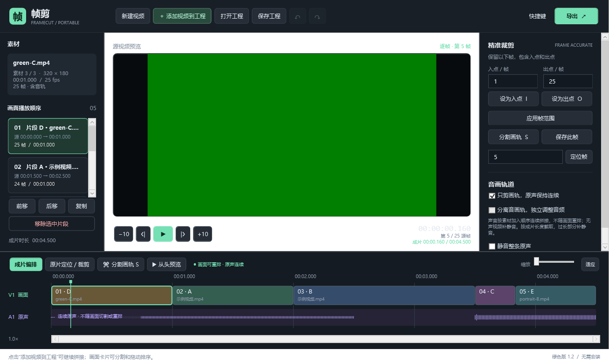

# FrameCut

A portable Windows video editor built with C#, WPF, and local FFmpeg tools. Current version: **1.2.1**.



## Features

- Add multiple videos to one project while preserving existing trims and clip order.
- Step forward and backward through actual source frames, set in and out points, and save full-resolution PNG images.
- Split the video track into clips, drag to reorder them, preview the sequence, and export the combined result.
- Keep the original audio continuous while reordering video by default. Audio can also follow the clips or use an independently selected range.
- Export MP4, video without audio, M4A / WAV, or separate video and audio files.
- Save projects, undo and redo edits, and open earlier single-video projects.

See the [user guide](docs/USER-GUIDE.zh-CN.txt) for detailed instructions. The application interface and user guide are currently in Simplified Chinese.

## Download

Download the portable application and complete source package from [Releases](https://github.com/jeromerlon99-svg/FrameCut/releases). Extract `FrameCut-Portable-v1.2.1.zip` and run `FrameCut.exe`; no installation is required.

## Requirements and dependencies

- Windows 10 / 11, 64-bit, with .NET Framework 4.8.
- FFmpeg and ffprobe, invoked as separate local processes.
- No NuGet, Python, Node.js, or online services are required to run the application.

**This repository includes the complete source archives for pinned versions of FFmpeg, x264, and zlib, along with build scripts.** Their binaries are distributed in the portable release package, whose `sources/` directory also contains the complete corresponding source. See the [dependency notes](docs/DEPENDENCIES.md).

## Build

Run the following command in PowerShell from the repository root:

```powershell
.\scripts\build.ps1
```

The output is `build/FrameCut/FrameCut.exe`. The script uses the .NET Framework C# compiler included with Windows, embeds the interface and icon, includes the application configuration, and copies the small demo video supplied in the repository.

To include the media tools, supply an `engine` directory from a portable release:

```powershell
.\scripts\build.ps1 -EngineDirectory 'D:\Tools\FrameCut\engine'
```

Then run `build/FrameCut/FrameCut.exe`. The build script preserves the FFmpeg license files and records the dependency versions actually used.

Alternatively, open `FrameCut.sln` in Visual Studio, install the .NET desktop development workload and .NET Framework 4.8 Developer Pack, and build with the Release / x64 configuration. `Main.xaml` is loaded as an embedded resource; the application uses its own entry point rather than an automatically generated WPF entry point.

## Verification

After building with an FFmpeg engine, run the following command in a Windows desktop session:

```powershell
.\tests\run-tests.ps1 -AppDirectory '.\build\FrameCut'
```

The checks use included synthetic video fixtures with pinned SHA-256 hashes. They verify exported frames, frame counts, audio order, silence padding, multiple-source imports, project save and restore, and cancellation. Interface checks run in the application's own off-screen windows without mouse or keyboard automation.

Version 1.2.1 passed all 123 checks using the new media tools built from source. See the [verification record](docs/verification-v1.2.1.txt). The basic GitHub workflow compiles the application and verifies the output files. A separate manual workflow builds the media tools from pinned source, runs the media checks, and creates a portable package with corresponding source.

## Project structure

```text
src/          Application code, interface, icon, build script, and Visual Studio project
tests/        Actual media processing and in-process interface checks
assets/       Demo video created for this project
scripts/      Application, media engine, and release packaging scripts
docs/         Usage, dependency, release, and verification documentation
third-party/  Pinned media source archives, licenses, build records, and hashes
.github/      Windows application build and complete release workflows
```

## Scope and limitations

FrameCut supports precise SDR video editing and joining multiple sources. Subtitles, transitions, filters, overlays, and multilayer compositing are not included. For each source, the application uses the first video stream that is not cover art and the first audio stream. The first source determines the output frame dimensions; other sources retain their aspect ratio and are padded with black borders as needed. Projects store file paths rather than embedding the original videos, with a limit of 200 sources and 200 video clips.

The first import scans the source to build a frame index. Continuous playback of some formats requires a locally generated compatible preview. Frame stepping and exports always read the original files. Some controller methods remain large and could be split up in future refactoring; the repository preserves the application implementation released in version 1.2.

## Open source and releases

The FrameCut application source is available under the [MIT license](LICENSE). The external FFmpeg build has separate license requirements; see the [third-party notices](THIRD-PARTY.md). The root license does not cover external binary components.

Corresponding source, dependencies, licenses, and build materials are archived in this repository. The packaging script automatically embeds a complete source ZIP for the same version in each new portable package. The portable and source packages can be published together as release assets. See the [publishing notes](docs/PUBLISHING.md).

Test fixtures can be regenerated using the complete recipes in `tests/generate-fixtures.ps1`. This requires a development FFmpeg build with the `lavfi` input enabled. The runtime build excludes device inputs; normal editing and media checks do not depend on the fixture generator.
